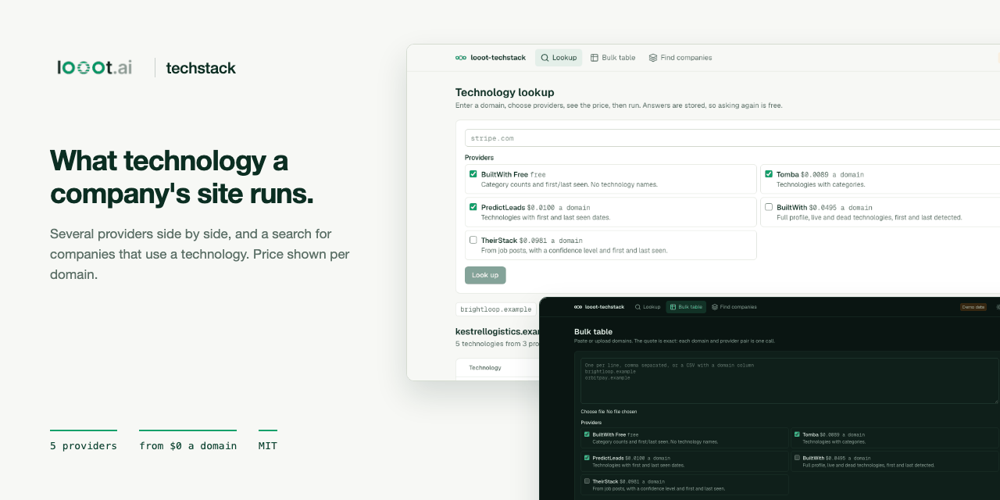
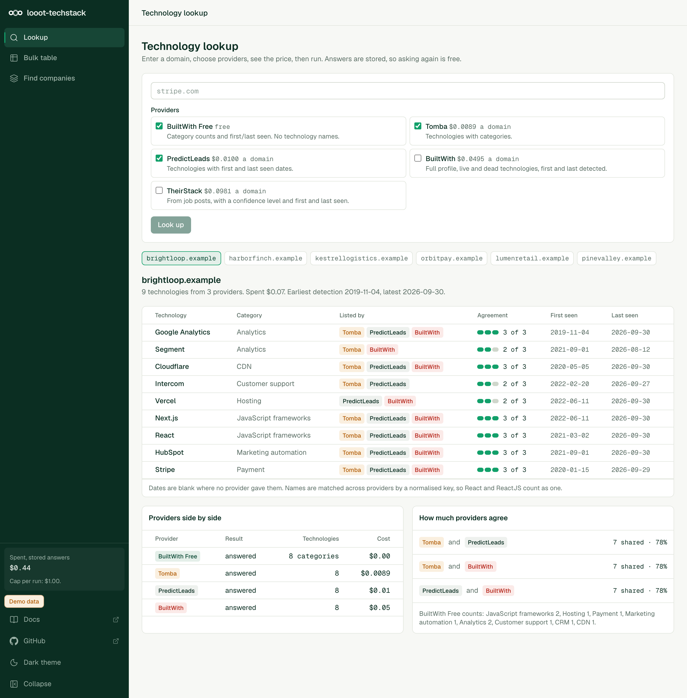
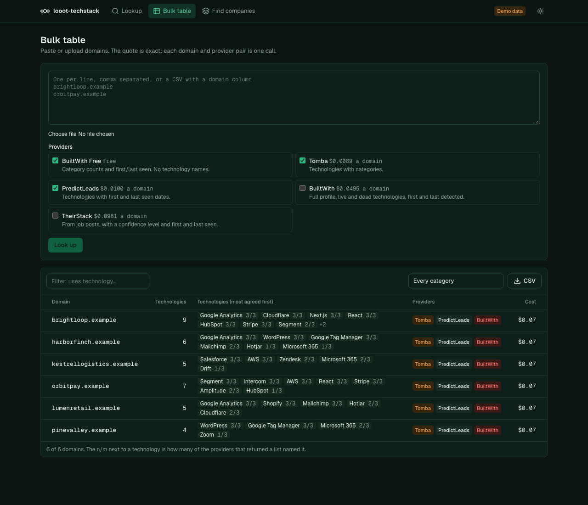

<p align="center"></p>

# looot-techstack

> **Security notice.** Versions 0.1.2 and older had no admin sign-in. Anyone who could reach a deployed instance could run paid lookups and finds on your looot balance, as often as they liked, and download the stored results. If you run 0.1.2 or older on a reachable host, upgrade to 0.1.3 and set `TECHSTACK_ADMIN_PASSWORD`. See [Securing a deployment](#securing-a-deployment).

[](LICENSE) [](https://github.com/loootai/looot-techstack/releases) [](https://docs.looot.ai)

An open-source alternative to [BuiltWith](https://builtwith.com/plans) and [Wappalyzer](https://www.wappalyzer.com/pricing/) lookups: what technology a company's website uses, and which companies use a technology. BuiltWith starts at $295 a month and Wappalyzer's paid plans at $250 a month, with a free tier of 50 lookups a month (public pricing pages, read 2026-10-10). This repo runs on one looot key and you pay list price per domain, from $0 up to a few cents.

It asks several technology providers about each domain and shows their answers side by side: technologies by category, which providers named each one, how much the providers agree, and first and last seen dates where a provider gives them.




## How it differs from the originals

BuiltWith and Wappalyzer run their own crawlers. This repo does not detect anything itself. It queries the providers behind looot's `company.technographics` job and compares them. That is slower to trust and cheaper to run, and the side-by-side view shows you where providers disagree instead of hiding it. Wappalyzer's browser extension and its own fingerprint database are not replicated.

## What you need

- Node 22.12 or newer. The repo has no `engines` field or `.nvmrc`. Next.js 16 needs 20.9 or newer and the test runner (Vitest 5) needs 22.12 or newer. I ran it on Node 24.
- npm.
- A looot account and token, only for real lookups. Sign up at https://looot.ai/auth/sign-up. To get a token, run `looot login` (`npm i -g looot`), which opens a browser approval. Or in the looot web app go to Settings, "Agent tokens", and create one (https://docs.looot.ai/get-started/sign-in). With no browser or in CI, create the token in Settings, Agent tokens, then `export LOOOT_TOKEN=...`. The token needs the scopes runs.execute, catalog.read, runs.read and usage.read.
- A funded balance. Minimum top-up is $5. Signing up adds no credit (https://docs.looot.ai/money).

No other account is needed. The app does not use Supabase, an LLM key or any other service.

## Try it in one minute

No account and no token.

```bash
git clone https://github.com/loootai/looot-techstack && cd looot-techstack
npm install --ignore-scripts
npm run demo
```

Open http://localhost:3530. The demo has no sign-in and shows a "Demo, no sign-in" badge. It refuses to start if `LOOOT_TOKEN` is set or a data file exists, unless you also set an admin password. It shows made-up companies with fixture answers. Stop it with Ctrl-C. To check the CLI without a token, see the dry run below.

## Run it with your own data

The web app (`npm run dev`, or `npm run build && npm start`) reads `.env.local`. The CLI does not read any env file, so export the variables in your shell.

```bash
cp .env.example .env.local     # web app only
export LOOOT_TOKEN=...         # CLI
```

| Variable | Required | What it does | Where to get it |
|---|---|---|---|
| `LOOOT_TOKEN` | Required for real lookups, not for `--dry-run` or the demo | Bearer token for the looot API | Settings, Agent tokens in the looot app, or `looot login` |
| `LOOOT_API_URL` | Optional | looot API base URL. Default `https://api.looot.ai` | Leave unset |
| `TECHSTACK_ADMIN_PASSWORD` | Required outside the demo | Admin password, 12 characters or more. Without it the admin pages and API are closed and `/login` shows a setup page. | Choose one |
| `TECHSTACK_ADMIN_PASSWORD_HASH` | Alternative | `scrypt$salt$key` instead of the plain password. Wins if both are set. | `npm run hash-password -- 'your password'` |
| `TECHSTACK_SESSION_SECRET` | Optional | Key that signs session cookies. Default: derived from the password. | Leave unset, or a long random string |
| `TECHSTACK_COOKIE_SECURE` | Optional | Set `0` to drop the Secure flag in production, only for plain-http testing. | Leave unset |
| `TECHSTACK_DATA` | Optional | State file the web app uses for stored answers. Default `data/techstack.json` | A path you choose |
| `TECHSTACK_CONFIG` | Optional | Config file the web app reads. Default `techstack.config.json` | A path you choose |
| `NEXT_PUBLIC_DEMO` | Optional | `1` turns on demo mode with fixture answers. `npm run demo` sets it | Do not set it for real use |

`techstack.config.json` sets the default `providers`, `spendCapUsd` (default 1) and `cacheDays` (default 30).

Input is one domain per line, comma separated, or a CSV with a `domain` column. URLs are reduced to the host. `examples/domains.csv` is a three-line example. Dry run first. It needs no token and calls nothing:

```bash
npm run techstack -- --domains examples/domains.csv --dry-run
```

Real output from that command:

```
3 domains x 3 providers: 0 answers already stored (free), the rest run.
  BuiltWith Free: 3 x $0.0000 = $0.00  [company.technographics, builtwith-free1-api-json]
  Tomba: 3 x $0.0089 = $0.03  [company.technographics, tomba-technology]
  PredictLeads: 3 x $0.0100 = $0.03  [company.technographics, predictleads-companies-technology-detections]
Total: $0.06. Spend cap: $1.00.
List prices dated 2026-10-10. The real charge is read from each run.
Dry run: no looot call was made and nothing was written.
```

Then the real run:

```bash
LOOOT_TOKEN=... npm run techstack -- --domains examples/domains.csv --cap 0.50
LOOOT_TOKEN=... npm run techstack -- --domain stripe.com --providers builtwith-free,tomba,predictleads,builtwith
npm run techstack -- --find HubSpot --dry-run     # companies using a technology
```

Results go to `out/techstack.json`, `out/techstack.csv` (one row per domain and technology) and `out/techstack.md`. Answers are stored in `state/techstack.json` for 30 days, so asking again is free. Change the folders with `--out` and `--state`. Run `npm run techstack -- --help` for every flag. The web app has a domain lookup, a bulk table with a technology filter and CSV export, and a "find companies" page. Its stored answers live in `data/techstack.json`, a different file from the CLI's.

## Spending

Four limits stand between a request and a charge, checked in this order: the quote, the cap per run, the period budget, then the call.

- The quote shows before any paid action, line by line. It is exact. Each domain and provider pair is one call.
- The cap per run is `--cap <usd>` on the CLI and `spendCapUsd` in `techstack.config.json`. The default is $1. A run stops before a call that would pass it and prints how many calls were not run. In the web app the cap is only the one in the config. The browser sends the total from the quote it saw (`quoteMicros`), the server prices the request again, refuses it if the price went up, and bounds the run by the lower of that total and the cap. A `capUsd` or any other cap field in a request is ignored.
- The period budget caps all runs together: a daily and a monthly amount (UTC), $10 and $50 until you change them. The signed-in owner changes them on the Costs page of the web app, or you set the starting values with `TECHSTACK_DAILY_USD` and `TECHSTACK_MONTHLY_USD`. A request to `/api/lookup` or `/api/find` cannot carry a budget: a request with a budget field is refused with 400. A request that does not fit what is left is refused with 409 and nothing is called. The CLI refuses it too (exit 2) unless you pass `--partial`, which runs until the budget stops it.
- Before each paid call the app reserves its list price in `budget.json` (next to the state file), under a lock file, and refuses the call if used plus reserved plus the price would pass the daily or the monthly budget. Two requests started together cannot both pass. When the call ends the reservation becomes the real charge. A call that looot answered with an error gives it back. A call still running at looot (`pending`) keeps its reservation: it is never recorded as failed at $0 and the budget is never handed back early. A network error also keeps it, since the request may have been accepted.
- The next paid request looks up every call that has a run id with `GET /v1/runs/{id}` and settles the ones that ended, to their real cost. A reservation that cannot be looked up is released after 24 hours.
- The sidebar and the Costs page show used, reserved and remaining for today and this month. At the budget the request is refused with a message that names the limit.
- In the web app, an identical request (the same domains or technology, the same providers) is answered from the stored result for 24 hours and calls looot zero times. A caller can also send an `idempotencyKey` (or an `Idempotency-Key` header). The same key with a different request is refused with 409. One session can start 10 paid requests per 10 minutes.
- The state file is written under a lock too. A paid run can take a minute, so the app merges its new answers into the file as it is at the end of the run instead of overwriting it. Two requests running at the same time keep both sets of answers.
- Each call sends a stable idempotency key per (provider, domain or technology, cache period), for example `techstack:tomba:stripe.com:p691`. There is no date or time in it. The cache period is `floor(time / cacheDays)`, so the key changes only after the stored answer has gone stale, and looot then runs a fresh lookup instead of replaying the old one. Inside a period a retry never pays twice. Changing `cacheDays` changes the period and so the keys.
- A finished call is also stored in `budget.json` under its key, so the same call is answered without a second request even if the state file is gone.
- Typical run at list price. 100 domains on the default three providers cost 100 x $0.0189 = $1.89. Adding BuiltWith makes it $6.84. The same 100 domains cost $0 to look up again for 30 days.
- A run still in progress when waiting stops is stored as pending. The next run collects it. It is never treated as failed at $0.
- Failed calls are not charged by looot. The tool reads the real charge from each run.
- The looot token balance is the final limit. Fund a dedicated token with only what you are willing to spend, and keep the budget below it.

The budget lives in a file, so run one instance on a disk that persists. Several instances, or a serverless host with a throwaway disk, do not share it. The CLI keeps its own `budget.json` next to its `--state` file; point `--state` at the web app's `data/techstack.json` to share one budget.

## Providers and prices

All five are the looot job `company.technographics`. Prices are list prices read from the public catalog on 2026-10-10.

| Provider | Endpoint | Price per domain | Gives | Default |
|---|---|---|---|---|
| BuiltWith Free | `builtwith-free1-api-json` | $0 | Category counts, first and last seen. No technology names. | on |
| Tomba | `tomba-technology` | $0.0089 | Technologies with categories | on |
| PredictLeads | `predictleads-companies-technology-detections` | $0.0100 | Technologies with first and last seen | on |
| BuiltWith | `builtwith-api-json` | $0.0495 | Full profile, live and dead, first and last detected | off |
| TheirStack | `theirstack-companies-technologies` | $0.0981 | From job posts, with a confidence level and dates | off |

Find companies using a technology:

| Provider | Endpoint | Price per search |
|---|---|---|
| BuiltWith Lists | `builtwith-lists12-api-json` | $0.0495 |
| PredictLeads | `predictleads-technologies-2` then `predictleads-discover-technologies-technology-detections` | $0.03 + $0.01 |

Typical run at list price: 100 domains on the default three providers cost 100 x $0.0189 = $1.89. Adding BuiltWith makes it $6.84. The same 100 domains cost $0 to look up again for 30 days.

## Agreement between providers

For each technology the app shows which providers listed it and "2 of 3": how many of the providers that returned a technology list named it. A provider that failed, is pending or only returns category counts does not count in the base. Technology names are matched by a normalised key (case, punctuation and a `.js` suffix are ignored, and a short alias list covers cases such as AWS and Amazon Web Services). Two providers that spell a product differently beyond that will show as two technologies. Add the spelling to `ALIASES` in `src/lib/parse.ts`. The overlap panel shows shared technologies and a percentage for each pair of providers.

## Securing a deployment

Versions 0.1.2 and older had no admin authentication. From 0.1.3 every route is either public on purpose or admin, and the admin routes are closed unless you set a password.

### What is public and what is admin

Pages and routes were listed from `src/app` and classified. A test reads the folder and fails if a route is missing from `src/lib/auth/routes.ts` or if an admin route does not call the gate.

| Kind | Count | Routes |
|---|---|---|
| Public | 4 | `/login`, `/api/auth/login`, `/api/auth/logout`, `/api/health` |
| Admin pages | 4 | `/` (lookup), `/bulk`, `/find`, `/costs` (budget and stored-answer costs) |
| Admin API | 5 | `/api/lookup` (paid), `/api/find` (paid), `/api/quote`, `/api/export` (stored results as CSV), `/api/budget` (read, and change the period budget) |

Any path not listed is treated as admin.

### How it works

- Set `TECHSTACK_ADMIN_PASSWORD` (12 characters or more) or `TECHSTACK_ADMIN_PASSWORD_HASH` (from `npm run hash-password -- 'your password'`). Without one, admin routes answer 503, admin pages go to `/login`, and `/login` says what to set.
- `src/proxy.ts` checks every request. Each admin page, the root layout and each admin route handler checks again with the same function, so a path the matcher misses is still closed.
- Sign-in compares the password in constant time. A session is a signed token in an httpOnly, SameSite=Lax cookie, Secure in production, valid for 8 hours. 5 wrong passwords from one address lock that address for 15 minutes. 40 wrong passwords from anywhere lock sign-in for everyone for 15 minutes.
- Every state-changing admin request needs a same-origin `Origin` header and the per-session token in `x-techstack-csrf`. The layout puts the token in a meta tag and the app's own calls send it.
- A paid request (`/api/lookup`, `/api/find`) needs the session, the CSRF token and the quote total it was shown. The server prices it again and refuses if the price went up. The cap and the period budget are the server's: the cap is `spendCapUsd`, the budget is set by the owner on the Costs page. The browser cannot raise either, and a request with a budget field is refused.
- An identical paid request is answered from the stored result and not paid for again, for 24 hours. A caller key with a different request is refused with 409. One session can start 10 paid requests per 10 minutes.
- The period budget (`PUT /api/budget`) is changed only by the signed-in owner, with the CSRF token. A run cannot raise it. See [Spending](#spending). The looot token balance is the final limit, so give the app a token funded with only what you are willing to spend. The budget file needs one instance on a persistent disk.
- Admin responses carry `Cache-Control: no-store`. All responses carry a Content-Security-Policy (`frame-ancestors 'none'`), `X-Frame-Options: DENY`, `X-Content-Type-Options: nosniff` and `Referrer-Policy: no-referrer`. The CSP allows inline scripts because Next.js needs them.
- The demo (`npm run demo`) has no sign-in and shows a "Demo, no sign-in" badge. It refuses to start next to a `LOOOT_TOKEN` or a data file unless an admin password is set.

### Set it up

```bash
export TECHSTACK_ADMIN_PASSWORD='a password of 12 or more characters'
# or keep it out of the environment as plain text:
npm run hash-password -- 'a password of 12 or more characters'   # prints TECHSTACK_ADMIN_PASSWORD_HASH=...
npm run build && npm start
```

A shared password is the floor. For anything people other than you can reach, put the app behind a VPN, a private network or an identity-aware proxy (Cloudflare Access, Tailscale, Google IAP, oauth2-proxy), and leave only the public routes in the table above reachable from the internet. Keep the app's password on as well. The rate limits are in memory, so behind several instances also limit at the proxy.

### What changes when you upgrade

- The web app asks for the password. Set `TECHSTACK_ADMIN_PASSWORD` before you start 0.1.3, or the admin pages stay closed.
- `/api/lookup` and `/api/find` now require `quoteMicros` in the body: the total from the quote the caller was shown. A script that posted only `{ text }` gets a 400 asking for a quote. The built-in screens send it.
- Answers to paid requests are kept in the state file for 24 hours, under `idempotency`.

### Upgrading to 0.1.4

- New file `budget.json` next to the state file, created on first use. No migration, nothing to run. The default budget is $10 a day and $50 a month. Set `TECHSTACK_DAILY_USD` and `TECHSTACK_MONTHLY_USD` before the first paid run if you want other starting values.
- Idempotency keys now end in a cache period (`:p656`). The first lookup after you upgrade for a pair that has no fresh stored answer is a new call, charged once.
- A paid request that does not fit the budget gets 409 with the reason, where 0.1.3 would have run it.

### Not covered

One admin, no per-user accounts or roles. The rate limits are in memory. The CLI has no sign-in: it runs as you on your machine and reads the same files.

## Deploy

There is no `vercel.json` and no GitHub workflow in this repo. The app keeps its stored answers in a JSON file on disk (`data/techstack.json`, or the path in `TECHSTACK_DATA`), so it needs a host with a writable, persistent disk. I have not deployed it. On such a host run `npm ci --ignore-scripts && npm run build && npm start`, and set `LOOOT_TOKEN` in the host's environment. Set `TECHSTACK_ADMIN_PASSWORD` too, serve it over HTTPS, and read [Securing a deployment](#securing-a-deployment). Without the password the app serves no admin page.

## Troubleshooting

| What you see | What it means and what to do |
|---|---|
| `LOOOT_TOKEN is not set. Create an agent token at https://looot.ai/settings, or use --dry-run.` | The CLI found no token. The quote prints first, then this line, exit code 2. Export `LOOOT_TOKEN` or add `--dry-run`. |
| `LOOOT_TOKEN is not set on the server, so the run is disabled.` | Web app with no token. Set it in `.env.local` and restart. |
| `looot returned HTTP 401` (or the API's own error message) in a provider's error column | The token is wrong, expired or lacks a scope. Create a new one with runs.execute, catalog.read, runs.read and usage.read. |
| `looot returned HTTP 402` (or the API's own message) | The balance is too low. The code does not check this itself. It stores the API's message for that call. Top up (minimum $5) and run again. |
| A provider shows `blocked` or `stopped` in the status column | looot did not run the call. The tool stores the status when the run has no error message, and charges nothing. Open the run in your looot app for the reason. |
| `Every call failed. See the error in the state file.` | Exit code 1. Open `state/techstack.json` and read the `error` of each call. |
| `Stopped at the $1.00 cap: N calls were not run. Run again with a higher --cap.` | The cap was reached. Raise `--cap` if you accept the cost. |
| `N calls are pending (still running at the provider). Run the same command again to collect them.` | Wait and run the same command. Pending runs are not charged twice. |
| `The technology was not found` | The reverse search could not resolve the technology name at PredictLeads. Try the exact product name. |
| A provider answers but the technology list is empty | The parser did not recognise the response shape. Fields that are not found stay blank on purpose. Open an issue with the raw response. |
| `No file at <path>` or `Give --domains, --domain or --find.` | Usage errors, exit code 2. |

How to file an issue. Open one at https://github.com/loootai/looot-techstack/issues with the run id (this tool does not print or store it, so give the idempotency key, for example `techstack:tomba:stripe.com:p691`, and the time of the call so the run can be found), the command you used, and the raw response body with secrets removed.

## Status

The test suite passes (31 tests), but it uses fixtures. If a parser fails on a real response, open an issue with the raw response body (see Troubleshooting).

- No paid looot run was made. Each provider parser is built from the provider's public documentation and from fixtures, not from a recorded paid response. Providers rename fields, and a field that is not found shows as blank, not as a guess.
- The inputs for the reverse search are the least certain part: `TECH` for BuiltWith Lists is documented, but the technology resolver input for PredictLeads (`technology_id_or_name`) and the `technology_id` for its discover call are inferred from the endpoint descriptions.
- The free BuiltWith answer is read as category counts with `latest` and `oldest` times. If its shape differs, the category panel stays empty.
- Dropped on purpose: Sumble (needs an organization id from a separate call), Datagma ($0.065 a domain, same data), list filters such as country and spend, historical trends, and a browser extension.
- A "find companies" search returns the provider's first page, not every site using the technology.

## Install for agents

```bash
git clone https://github.com/loootai/looot-techstack && cd looot-techstack && npm ci
npm run techstack -- --domains examples/domains.csv --dry-run
```

The Claude Code skill is `skills/looot-techstack/SKILL.md` (copy it to `~/.claude/skills/`). `public/llms.txt` summarises the commands. The skill dry-runs first, keeps paid providers opt-in and never raises the cap on its own.

## Develop

```bash
npm test && npm run typecheck && npm run lint && npm run build
npm run leak-scan
git config core.hooksPath .githooks
```

Stack: TypeScript, Next.js App Router, Tailwind. Built on [looot](https://looot.ai): one key and one prepaid balance for 2,500+ data endpoints, failed calls cost nothing.

## Licence

MIT, copyright looot.

## Related

Other open-source projects built on [looot](https://looot.ai):

- [looot-intent](https://github.com/loootai/looot-intent): account intent and buying-stage scoring (6sense)
- [looot-score](https://github.com/loootai/looot-score): lead and ICP fit scoring (MadKudu)
- [looot-reveal](https://github.com/loootai/looot-reveal): which companies visit your site (RB2B, Clearbit Reveal)
- [looot-signals](https://github.com/loootai/looot-signals): hiring, funding and news triggers (TheirStack, Harmonic)
- [looot-lookalike](https://github.com/loootai/looot-lookalike): lookalike company search (Ocean.io)
- [looot-ads](https://github.com/loootai/looot-ads): competitor ad board (Foreplay)
- [looot-reviews](https://github.com/loootai/looot-reviews): review themes and weak spots (ReviewTrackers)
- [looot-battlecards](https://github.com/loootai/looot-battlecards): competitor battlecards (Klue, Crayon)
- [looot-mentions](https://github.com/loootai/looot-mentions): brand and keyword listening (Brand24)
- [looot-warm-leads](https://github.com/loootai/looot-warm-leads): warm leads from LinkedIn intent signals (Gojiberry)
- [looot-crm](https://github.com/loootai/looot-crm): a small CRM with buying signals built in
- [looot-seo](https://github.com/loootai/looot-seo): self-hosted SEO workspace
- [looot-monitor](https://github.com/loootai/looot-monitor): brand and competitor monitoring with alerts
